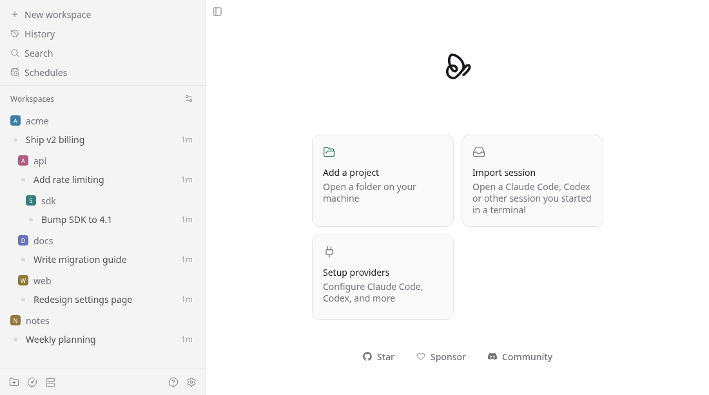

# paseo-nested-workspaces

Paseo plugin that nests the sidebar's workspace list by directory, like the DeepSeek harness "Workspace Tree".



Paseo lists every project at the top level, so `~/app` and `~/app/api` sit side by side. With this plugin a project whose directory lies inside another project's directory is shown under it, indented 12px per level, and folds away with its parent. The built-in list is rearranged in place: no extra screen, no replacement list.

## How it works

Paseo 0.15 has no API to change the built-in list (`addSidebarView`, on Paseo's main branch, replaces the whole list and is not released). `client/web.ts` reads each project's directory from its row's `data-testid`, computes the tree in `client/tree.ts`, and sets `order`, `padding-left` and `display` on the project sections. It never moves nodes, and leaves the list alone when the markup is not what it expects. A scoped stylesheet also tightens the list: 28px rows instead of 36px, 2px between projects instead of 12px. Disabling the plugin removes the styles.

Limits: desktop and web only (a no-op on iOS and Android), tied to Paseo's sidebar markup, nested projects come after the parent's own workspaces, and drag reordering is untested with nesting on.

## Development

```bash
bun install
bun test
bun run typecheck
paseo plugin install /absolute/path/to/paseo-nested-workspaces
```

The plugin ID is `nested-workspaces`. Plugins are unsandboxed; the daemon has to run with plugins enabled. After an edit, run `paseo plugin reload nested-workspaces`.

Changes are recorded in [docs/provenance.md](docs/provenance.md).
